<!-- Synthwave Hero Banner -->

  

 

### Connect with me. 🌐

  
  
  
  
  

 

### About Me. 🚀

- 👋 Hi, I'm **John Conte** (`@JontCont`) — a developer who loves building clean, pragmatic software.
- 💻 **Focus:** Full-stack web apps, APIs, automation & developer-friendly tooling.
- 🌱 **Currently Exploring:** System design, AI workflows & cloud-native architecture.
- 🛠️ **Currently Working On:** Personal productivity tools & open-source experiments.
- 📝 **Writing:** Sharing notes & builds on my blog — [blog.startfms.uk](https://blog.startfms.uk/).
- ☕ **Support:** If my work helps you, feel free to [buy me a coffee](https://portaly.cc/startfms5/support)!
- 📫 **Reach Me:** [johncont99688@gmail.com](mailto:johncont99688@gmail.com)

 
 

### Tech Stack. 🧰

  

 

### Featured Projects. ✨

- 📦 **[Project Alpha](https://github.com/JontCont)** — *A brief one-liner describing what this project solves and why it's cool.* (`TypeScript` · `Next.js` · `PostgreSQL`)
- ⚡ **[Project Beta](https://github.com/JontCont)** — *A CLI or automation tool that streamlines daily developer workflows.* (`Python` · `FastAPI` · `Docker`)

 

### Stats. 📊

  
  

  

 

<!-- Colorful Wave Footer -->

  

